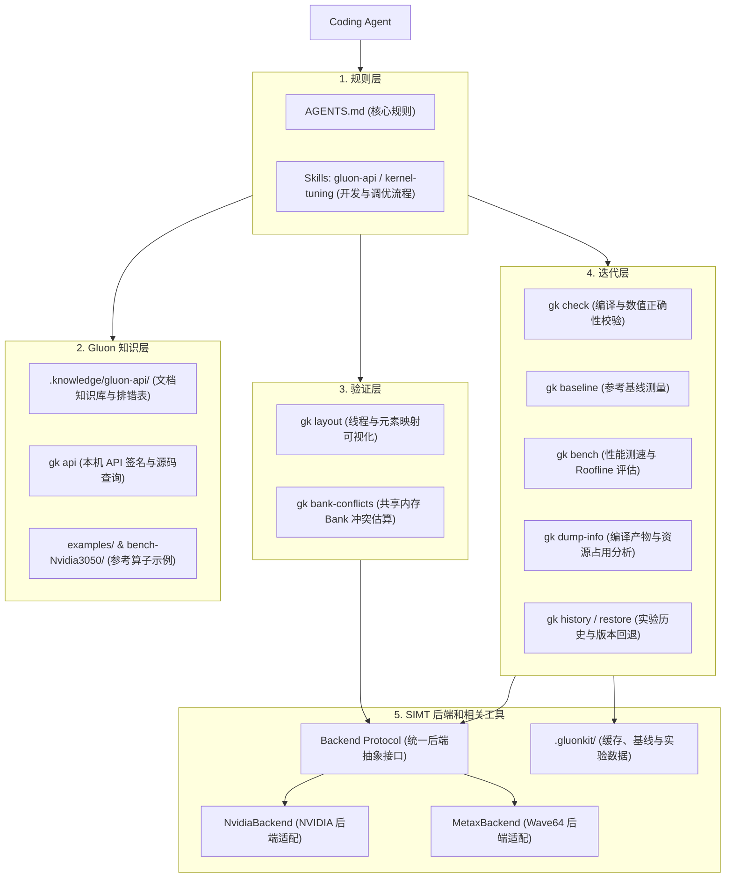
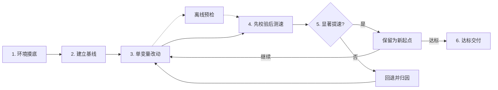

> **GluonKit 目的**：让 Coding Agent 能够独立、可靠地使用 Gluon 编写并调优高性能 GPU 算子

## 核心设计思想：

1. 提供gluon相关知识库，因为gluon是实验性质的且相关文献很少，目的是让agent会用gluon写
2. 制作一套cli工具提供调优过程中的性能数据等关键信息，目的是减少他获取信息的负担，同时能避免他直接读几万行的文件，减少幻觉
3. 制定一套sop，让agent根据sop去操作

---

## 总体分层架构

---

## 优化核心思想：控制变量 + 迭代

[.agents/skills/kernel-tuning/SKILL.md](.agents/skills/kernel-tuning/SKILL.md) 制定了一个SOP，也有点经验模块的感觉，整体流程是这样的：

> 两大模块提供迭代的能力：`gk history + gk restore`

---

## Gluon 知识库设计

### 1. 静态知识库（`.knowledge/gluon-api/`）

1. **通用 API 文档（`gluon-api-common.md`）** 做了一层通用原语的分类和索引
2. **平台专用 API 文档（`nvidia.md`、`nvidia-sm86.md`）** 后续接入其他平台时，在同级新建对应平台目录
3. **Gluon 报错速查文档**

### 2. 动态查询（`gk api`）

获取详细的api参数和gluon源码中的注释说明。这样设计是避免知识库太大挤爆上下文，即用即查的理念

---

## TODO 后续演进的方向

主要应该是知识库方面的，看下怎么更完善，以及提供一些case或者经验教训
